# scView

**A Docker-based, browser-native workspace for single-cell RNA-seq, with an AI co-pilot and built-in provenance.**

scView pairs interactive, linked visualizations (UMAP/t-SNE/PCA, gene expression, clusters,
markers, gene sets, pathway enrichment) with two things most single-cell tools lack: an **AI
assistant that interprets your data and coaches the next analysis step**, and **built-in
provenance**, "git for the h5ad", so you can always answer *"what was done to this data, and
why?"* Wet-lab and dry-lab users go from a raw matrix to annotated, reproducible figures without
writing code.

https://github.com/user-attachments/assets/486aaf9d-bf77-4a20-9f1f-28bc3bf81e8c

*A full run-through with an on-screen real-time clock: load a dataset, AI-assisted assessment, Unified View, cluster colors, marker-gene expression, 3D embedding, enrichment. Fast-forwarded sections visibly race the clock.*

## Contents

- [Why scView](#why-scview)
- [Screenshots](#screenshots)
  - [Unified View](#unified-view)
  - [Differential expression (volcano)](#differential-expression-volcano)
  - [Pathway enrichment: programs, not a wall of terms](#pathway-enrichment-programs-not-a-wall-of-terms)
  - [Joint embedding across datasets](#joint-embedding-across-datasets)
  - [Compare datasets](#compare-datasets)
  - [AI co-pilot](#ai-co-pilot)
  - [Literature-grounded answers](#literature-grounded-answers)
  - [Methods from provenance](#methods-from-provenance)
  - [AI-assisted Data Assessment](#ai-assisted-data-assessment)
  - [Proactive insight on open](#proactive-insight-on-open)
  - [History / provenance](#history--provenance)
  - [Forgiving data import](#forgiving-data-import)
- [Installation and usage](#installation-and-usage)
  - [Requirements](#requirements)
  - [Windows, step by step](#windows-step-by-step)
  - [Windows troubleshooting](#windows-troubleshooting)
  - [macOS and Linux](#macos-and-linux)
  - [Other ways to start](#other-ways-to-start)
  - [Once it's running](#once-its-running)
  - [First steps](#first-steps)
  - [Optional: enable the AI features](#optional-enable-the-ai-features)
  - [Updating](#updating)
- [Architecture](#architecture)
- [Development](#development)
- [Status](#status)
- [License](#license)

---

## Why scView

Single-cell analysis forces a split: code-first pipelines (Scanpy/Seurat) are powerful but
inaccessible; point-and-click viewers (cellxgene, Loupe) mostly *display precomputed results*.
Neither **interprets** the data for you nor **records** what was done in a way a collaborator or
reviewer can audit. scView closes both gaps:

- **AI co-pilot (grounded and cited).** Ask about your data in plain language. Answers are grounded
  in your dataset's results plus provenance **and** a scRNA-seq methods/literature corpus (with
  cross-encoder reranking for sharper citations), linked to PubMed or jump-to-cluster. A cheap intent
  classifier routes each question so it only spends what it needs, and it's available even before a
  dataset is loaded. The co-pilot also **drives the UI** ("color by cell type", "run clustering at
  resolution 1.0") via confirm-gated, allow-listed actions, **answers "what is this?"** from a ✦ on any
  cluster, gene, marker, or pathway, and can **write a methods paragraph** from the provenance recipe.
- **AI-assisted assessment.** A deterministic assessor reports the state of ~15 preprocessing
  steps; an LLM advisor recommends the next steps with reasons and sized parameters; *you* always
  approve before anything runs. A one-line "I notice…" insight on open points you at the right next step.
- **Provenance: "git for the h5ad".** Every step is recorded into the data as a commit-style,
  replayable recipe with dependency-aware *edit and re-run from here*. Originals stay immutable.
- **Cell-type annotation, three ways.** Tissue-agnostic LLM-from-markers (default, no reference model
  to pick), reference-based CellTypist, or an offline marker-score method; labels are editable inline.
- **Forgiving multi-format ingestion.** h5ad, 10x MEX/HDF5, loom, zarr, dense CSV, Seurat `.rds`,
  and nf-core/scrnaseq outputs, via a guided "Add Data" flow.
- **Unified, linked, server-backed exploration.** A Kana-style single screen: scatter plus tabbed
  Markers/Expression/Gene Sets/Enrichment/DE plus violin, scaling to ~200k cells via a FastAPI
  backend, Apache Arrow, and deck.gl. Lasso (or click) a population for a **volcano of differential
  expression**, and export any table to CSV. **Compare two datasets'** cell-type composition side by
  side, gauge **batch-integration quality**, and your workspace is **restored across reloads**.
- **Joint embedding across datasets.** Pick two or more datasets and scView merges their raw counts
  on the shared genes (recovering counts from the original upload if processing replaced them),
  then processes them together with Harmony: one UMAP, one clustering and one marker set, with a
  `dataset` column for each cell's origin and the uncorrected UMAP kept for a before/after check.
  The DE tab's **Between groups** mode then compares datasets or conditions within a single cell
  type or cluster. The source datasets are never modified.
- **Pathway enrichment that stays readable.** Over-representation analysis against MSigDB
  collections (downloaded from the Broad Institute on first start) (Hallmark, GO, Reactome, KEGG, cell-type signatures), scored against the genes your
  experiment actually measured. A **Programs view** then collapses the usual wall of near-duplicate
  terms into a few biological programs (clustered on their shared genes and ranked by significance),
  and ribosomal/mitochondrial genes are filtered from the query by default, so cell-type and pathway
  labels stay tissue-appropriate instead of drowning in a generic "translation" signal. Click any
  term or program to score its genes on the embedding.

> Trust by design: the *facts* about your data are computed deterministically and reproducibly; the
> *LLM only advises*, and every action it suggests is approved by you and recorded in provenance.

---

## Screenshots

### Unified View
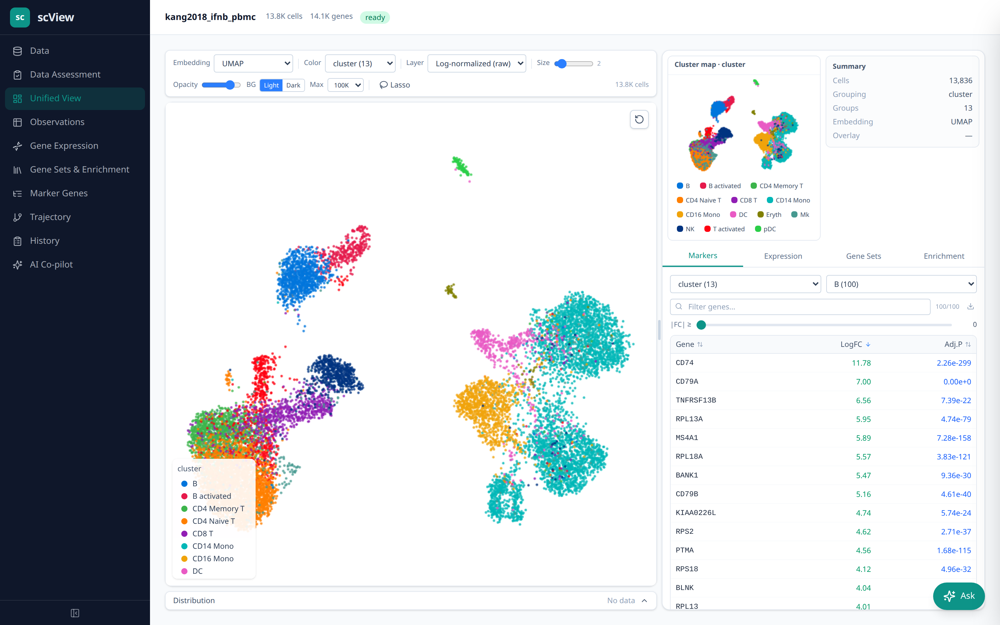
*One linked screen: a UMAP colored by cell type, a camera-linked cluster reference map, a summary
card, and a sortable markers table; recoloring, violins, and cluster highlighting all linked.*

### Differential expression (volcano)
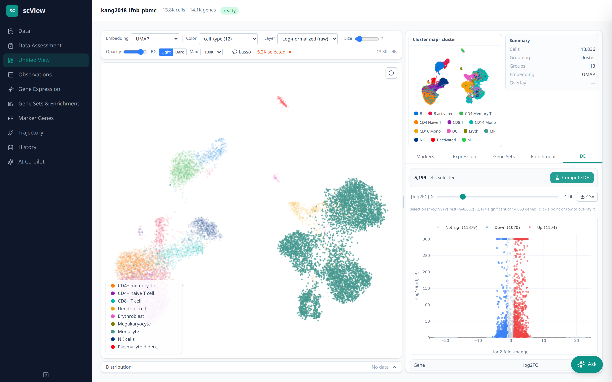
*Lasso a region or click a population (here Monocytes, 5,199 cells), then compute one-vs-rest
differential expression over all genes as an interactive volcano plus a significant-gene table;
click a point to overlay that gene, and export the table to CSV.*

### Pathway enrichment: programs, not a wall of terms
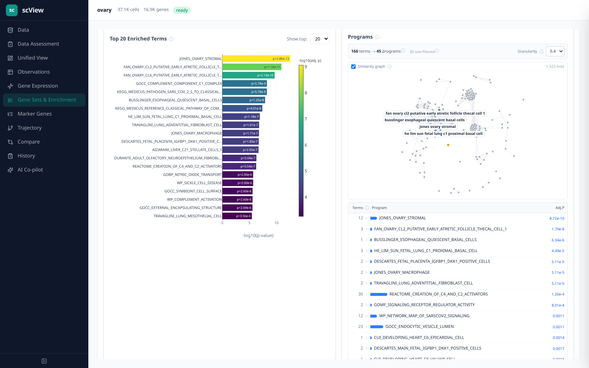
*The same over-representation result two ways: a familiar ranked bar chart (left), and a **Programs**
view (right) that clusters the redundant terms on their shared genes into a few labeled programs,
with a similarity graph. Ribosomal and mitochondrial genes are filtered from the query by default,
so an ovary sample resolves to ovary cell types (stromal, granulosa, follicle) rather than a generic
"translation" signal. Click any term or program to score its genes on the embedding.*

### Joint embedding across datasets
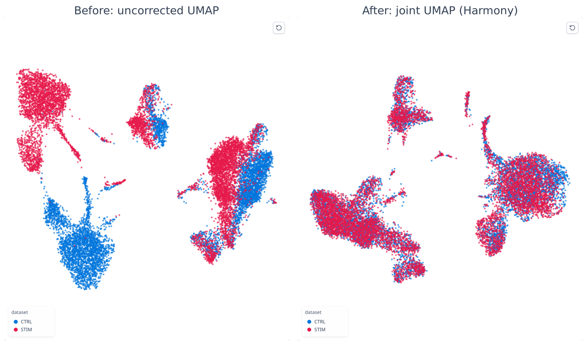
*The Kang et al. (2018) PBMCs imported as two datasets, control and IFN-β stimulated, then
integrated from the Compare tab. Before correction the interferon response splits every cell type by
condition (left); in the joint UMAP the conditions overlay while cell types stay apart (right). Each
joint cluster holds 42-58% of each condition. Between-groups DE of STIM vs CTRL within monocytes
then recovers the expected interferon-stimulated genes (CXCL10, ISG15, IFIT1-3, RSAD2, MX1).*

### Compare datasets
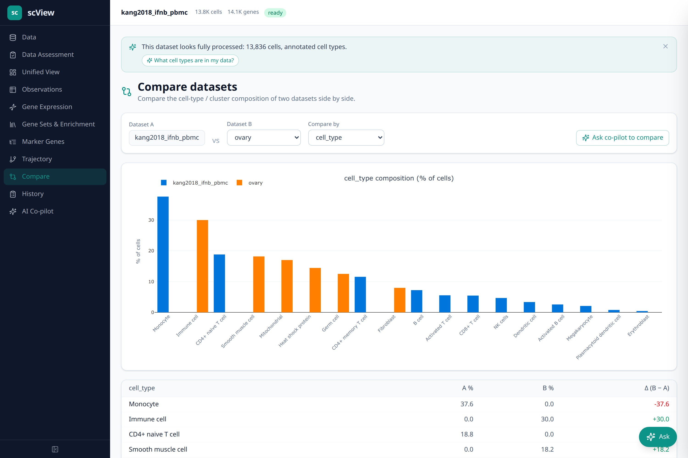
*On the Composition tab, pick a second dataset and a shared categorical column (cell type / cluster)
to compare their composition side by side — grouped proportions plus a Δ table, with one click to
ask the co-pilot what the differences mean.*

### AI co-pilot
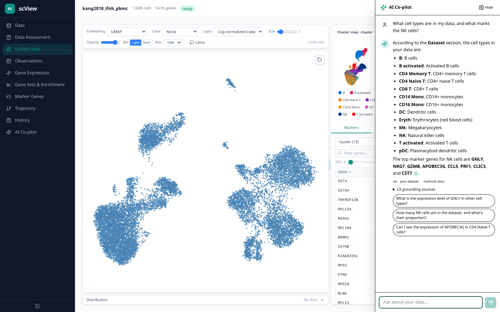
*Ask about your data and get a grounded, cited answer: here the cell types and NK-cell markers,
with a "via" route badge, expandable grounding sources, and suggested follow-ups. Citation chips
link to PubMed or jump to the cluster in the app.*

### Literature-grounded answers
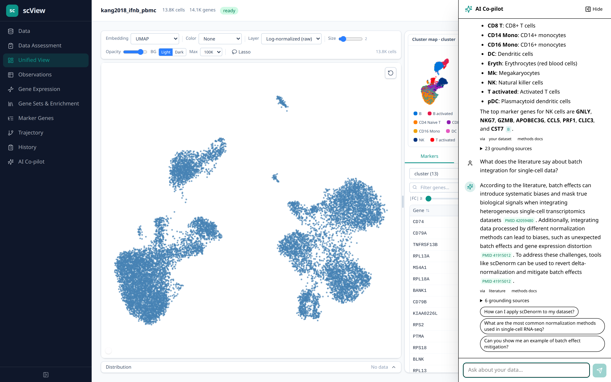
*Methods questions ("what does the literature say about batch integration?") route to the scRNA-seq
literature/tutorial corpus and come back with cited, reranked sources and suggested follow-ups,
while in-app facts stay grounded in your dataset.*

### Methods from provenance
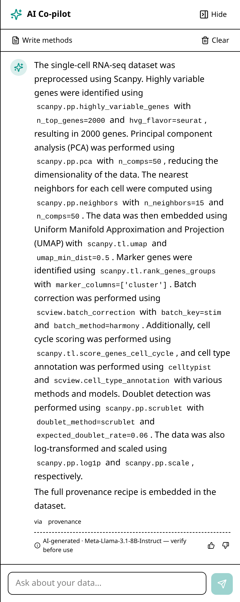
*One click turns the recorded provenance recipe into a methods-section paragraph, grounded strictly
in the steps, tools, and parameters that actually ran. Every answer shows which model produced it
with an "AI-generated, verify" note and a thumbs up/down.*

### AI-assisted Data Assessment
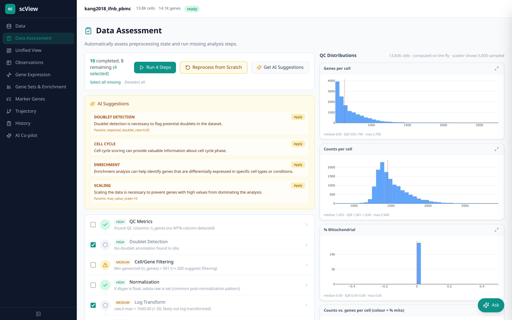
*QC distribution plots plus a preprocessing step list. "Get AI Suggestions" returns recommended
next steps with reasoning and parameters; one click to apply, you decide whether to run.*

### Proactive insight on open
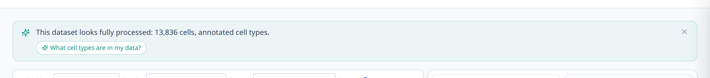
*When a dataset opens, a one-line "I notice…" banner names the most useful next step (chosen from the
preprocessing state, including QC anomalies) with a click-to-ask follow-up the co-pilot answers or runs.*

### History / provenance
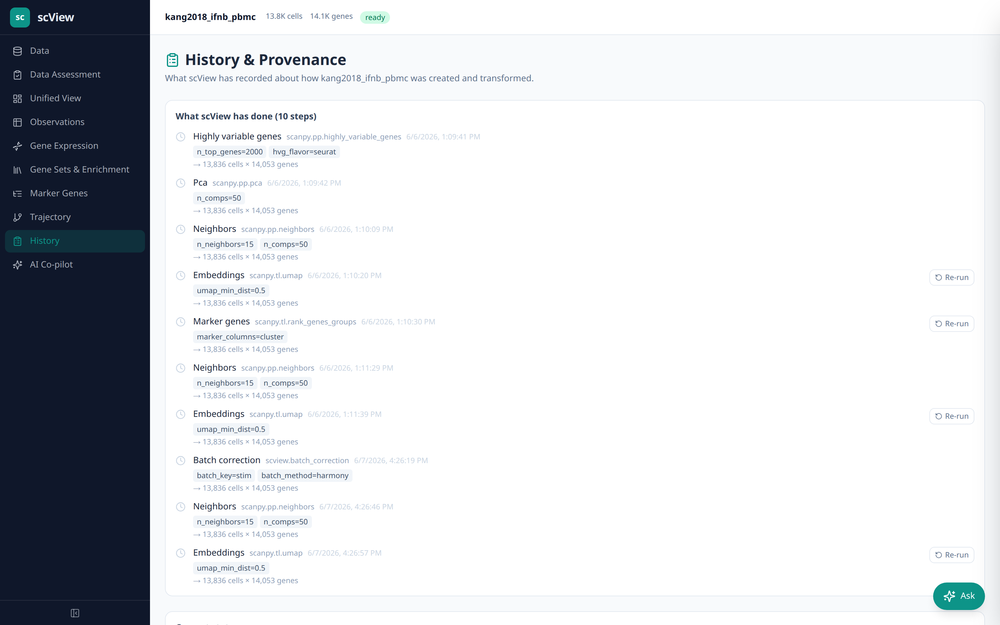
*Every recorded step as a timeline ("git for the h5ad"), with dependency-aware edit-and-re-run and
an exportable, replayable recipe.*

### Forgiving data import
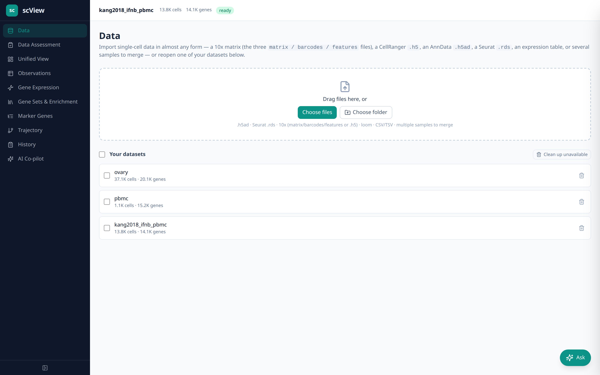
*Drop almost any format: 10x matrix/HDF5, h5ad, loom, CSV, Seurat `.rds`, or nf-core outputs;
reopen or manage previously loaded datasets.*

---

## Installation and usage

scView runs entirely in Docker, so there is no Python, Node, or R to install. **On Windows, follow
[Windows, step by step](#windows-step-by-step)**: no command line needed.

### Requirements

- **Docker:** Docker Desktop on Windows and macOS, Docker Engine on Linux, with **Docker Compose
  v2.24 or newer** (current Docker Desktop includes it).
- **RAM:** ~8 GB runs the stack and small-to-medium datasets (up to ~tens of thousands of cells)
  fine. For **large datasets (100k+ cells)**, the **Seurat `.rds` converter**, or heavy steps
  (doublet detection, Harmony, enrichment) on big data, **16 GB+ is recommended**; at 8 GB those
  can be slow or run out of memory.
- **Disk:** about 4 GB for the images; have **10 GB free** for the first start.
- **Internet on the first start**, to download the images and the MSigDB gene sets.
- A modern browser.

### Windows, step by step

You install Docker Desktop once, then start and stop scView by double-clicking.

1. **Make sure you can install software.** Docker Desktop needs administrator rights, so on a work
   or university PC you may need to ask IT to install it.
2. **Install [Docker Desktop](https://www.docker.com/products/docker-desktop/).** Keep the default
   **Use WSL 2** setting and restart the computer when asked. If Docker Desktop then asks to
   install or update WSL, let it.
3. **Open Docker Desktop** from the Start menu and wait until it shows **Engine running**. You can
   skip signing in.
4. **Download scView:** at the top of this GitHub page, click **Code → Download ZIP**. In your
   Downloads folder, right-click the ZIP, choose **Extract All**, and open the extracted
   `scView-main` folder. Running the files from inside the ZIP without extracting will not work.
5. **Double-click `start-windows.bat`** (it may show as `start-windows`, type *Windows Batch
   File*). If Windows shows a security warning, choose **Run**, or **More info → Run anyway**.
   A window opens that:
   - asks for an optional DeepInfra API key for the AI features (press Enter to skip),
   - downloads and starts scView. **The first run downloads a few GB**; later starts take about
     a minute. If a prebuilt part isn't available yet, it is built on your computer instead,
     which can take tens of minutes (a "must be built from source" warning means just that),
   - opens scView in your browser at **http://localhost:3000**.
6. **Load some data:** see [First steps](#first-steps).

**To stop scView**, double-click `stop-windows.bat`. **To start it again later**, open Docker
Desktop and double-click `start-windows.bat`, or in Docker Desktop open **Containers**, press ▶
next to **scview**, and go to http://localhost:3000. Your datasets are stored inside Docker, not
in the scView folder, so stopping, restarting, and [updating](#updating) all keep them.

### Windows troubleshooting

| What you see | What to do |
| --- | --- |
| `start-windows.bat` says Docker Desktop is not installed, but you installed it | Restart the computer so Windows finds Docker's commands. |
| Docker Desktop says virtualization is not enabled, or shows a WSL error | Virtualization has to be switched on in the PC's BIOS/UEFI settings (called Intel VT-x, or AMD-V / SVM). Then run `wsl --update` in PowerShell and restart. On a managed PC, ask IT. |
| "Docker Desktop did not start" | Open Docker Desktop yourself, wait for **Engine running**, and run `start-windows.bat` again. |
| "port is already allocated" | Another program is using port 3000, 8080, or 8001. Close it or restart the computer, then try again. |
| A large dataset fails, or the app becomes very slow | Docker on Windows can use only half of the computer's memory by default. To raise it, see below. |
| Gene sets or pathway enrichment are empty | On the first start scView downloads the MSigDB gene sets (~45 MB) in the background. Wait a minute and reload the page. This needs internet access to `data.broadinstitute.org`; if the download failed, it is retried on the next start. |
| Something else | Copy the last lines of the window's text into an [issue](https://github.com/thirtysix/scView/issues). |

To give Docker more memory, create a file named `.wslconfig` in your user folder
(`C:\Users\<your name>`) containing these two lines, adjusting the number to leave a few GB for
Windows itself:
```ini
[wsl2]
memory=12GB
```
Then run `wsl --shutdown` in PowerShell and reopen Docker Desktop.

### macOS and Linux

1. **Install Docker.**
   - **macOS:** install and open **[Docker Desktop](https://www.docker.com/products/docker-desktop/)**.
   - **Linux:** install **Docker Engine** plus the Compose plugin:
     ```bash
     # Ubuntu/Debian
     sudo apt install docker.io docker-compose-v2
     # Fedora/RHEL
     sudo dnf install docker docker-compose-plugin
     # Arch
     sudo pacman -S docker docker-compose
     # then enable the daemon and allow your user to run Docker:
     sudo systemctl enable --now docker
     sudo usermod -aG docker "$USER"     # log out/in afterward
     ```
     If `docker compose version` reports a version older than 2.24 (older distribution
     releases), install from [Docker's own repository](https://docs.docker.com/engine/install/)
     instead.

   Confirm Docker is ready:
   ```bash
   docker --version && docker compose version && docker info
   ```
2. **Get the code**, with Git or via **Code → Download ZIP** on this page:
   ```bash
   git clone https://github.com/thirtysix/scView.git
   cd scView
   ```
3. **Start scView** with the guided script:
   ```bash
   ./start.sh --prod           # recommended: prebuilt images  -> http://localhost:3000
   ./start.sh --prod --build   # same, built from source
   ./start.sh                  # development stack, hot-reload -> http://localhost:5173
   ./start.sh --stop    # stop all services (datasets are kept)
   ./start.sh --clean   # remove containers, images AND all uploaded datasets (asks first)
   ```
   `start.sh` checks prerequisites, creates `.env` (asking for an optional API key), downloads
   the prebuilt images (or builds them: the development stack and `--build` always do, and the
   first build can take tens of minutes), waits for health checks, and opens the app.

### Other ways to start

On any platform, Compose works directly. A `.env` file is optional; copy `.env.example` to `.env`
to change settings.
```bash
docker compose up -d                                   # prod, prebuilt images -> http://localhost:3000
docker compose up -d --build                           # prod, built from source
docker compose -f docker-compose.dev.yml up --build    # dev                   -> http://localhost:5173
docker compose down                                    # stop (datasets are kept)
```
The production images are published to GitHub's container registry for each release, for both
Intel/AMD and ARM machines: `ghcr.io/thirtysix/scview-backend`, `scview-frontend` and
`scview-converter`. `docker-compose.yml` pins them to the release version and builds any image
that isn't published; set `SCVIEW_VERSION` in `.env` to use another tag.
Or with `make`:
```bash
make up      # prod stack -> http://localhost:3000
make dev     # dev stack  -> http://localhost:5173
make down    # stop
```

### Once it's running

| Service | URL |
| --- | --- |
| **App** (prod / dev) | http://localhost:3000 , http://localhost:5173 |
| **Backend API plus interactive docs** | http://localhost:8080 , http://localhost:8080/docs |
| **R converter** (Seurat `.rds` to h5ad) | http://localhost:8001 |

> **Running on localhost is safe by default.** scView assumes a single trusted user and ships
> unauthenticated. **Do not expose it to the internet as-is** — every endpoint (AI co-pilot + compute)
> is open, so anyone who can reach the port spends your LLM budget and CPU. Before exposing it, read
> [`SECURITY.md`](SECURITY.md): set `DEPLOYMENT_MODE=public` (enables input hardening + a startup
> self-check), set an `ACCESS_TOKEN`, and put real auth + rate limiting in front.

### First steps
1. Open the app and use **Add Data** (the **Data** tab).
2. Drop in a dataset: `.h5ad`, a 10x matrix (MEX or HDF5), `.loom`, `.zarr`, a dense `.csv`, a
   Seurat `.rds`, or an nf-core/scrnaseq output. *(No data handy? Download 10x Genomics' 1k PBMC
   sample,
   [`pbmc_1k_v3_filtered_feature_bc_matrix.h5`](https://cf.10xgenomics.com/samples/cell-exp/3.0.0/pbmc_1k_v3/pbmc_1k_v3_filtered_feature_bc_matrix.h5)
   (5 MB), and drop it in as it is.)*
3. Open **Data Assessment** for QC plots plus AI-suggested next steps, then explore in **Unified
   View** and ask the **AI Co-pilot**.

Pathway enrichment and gene-set scoring use the
[MSigDB](https://www.gsea-msigdb.org/gsea/msigdb/) collections. scView does not ship them: on the
first start the backend downloads them (~45 MB) from the Broad Institute in the background, and
they are subject to [MSigDB's terms](https://www.gsea-msigdb.org/gsea/msigdb_license_terms.jsp).
Set `MSIGDB_AUTO_DOWNLOAD=false` in `.env` to skip the download.

### Optional: enable the AI features
Add a [DeepInfra](https://deepinfra.com/dash/api_keys) API key. The start scripts ask for one on
the first run; to add or change it later, open the `.env` file in the scView folder in a text
editor (on Windows: right-click → **Open with** → **Notepad**), set this line, save, and start
scView again:
```bash
DEEPINFRA_API_KEY=your-key-here
```
Without a key the assistant degrades gracefully to deterministic, rule-based guidance. The RAG
co-pilot's literature/tutorial corpora additionally require a Postgres/pgvector connection string
(`RAG_DATABASE_URL`); see [`docs/AI_ASSISTANT.md`](docs/AI_ASSISTANT.md).

### Updating
- **Downloaded ZIP:** download and extract the new ZIP, copy your `.env` file across from the old
  folder if you set an API key, and start scView from the new folder as before.
- **Git:** run `git pull`, then start scView as before.

Your datasets live in a Docker volume (`scview_dataset_data`), not in the scView folder, so they
carry over. Only `./start.sh --clean`, `make clean`, or deleting that volume in Docker Desktop
removes them.

---

## Architecture

Three Docker services:

- **backend**: FastAPI (`backend/src/scview`): AnnData I/O with lazy loading plus LRU cache, an
  on-demand analysis pipeline (scanpy / harmonypy / gseapy / Scrublet), the AI assessor plus advisor
  plus RAG co-pilot, and Apache Arrow IPC serialization.
- **frontend**: React 18 plus Vite plus TypeScript plus deck.gl, with Web Workers for Arrow decoding.
- **converter**: an R service (sceasy) that converts Seurat `.rds` to h5ad.

More detail: [`docs/ARCHITECTURE.md`](docs/ARCHITECTURE.md) ,
AI assistant design: [`docs/AI_ASSISTANT.md`](docs/AI_ASSISTANT.md).

## Development

```bash
make test          # backend test suite (pytest)
ruff check backend/src
( cd frontend && npm run build )   # strict type-check plus production build
```

## Status

Active development (Phase 6: polish and testing). The AI co-pilot, dual-corpus RAG, provenance, and
multi-format ingestion are implemented; see [`docs/AI_ASSISTANT.md`](docs/AI_ASSISTANT.md) and
[`docs/FUTURE.md`](docs/FUTURE.md) for the roadmap.

## License

Released under the **[MIT License](LICENSE)**, (c) 2026 Harlan Barker.
